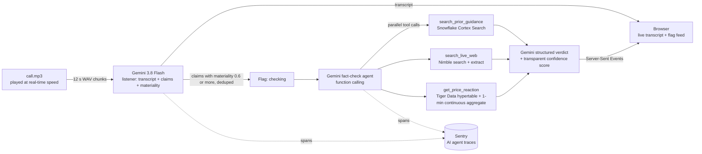

# Call Desk

**Hears earnings calls live and fact-checks every market-moving line in seconds.**

Corporate IR and FP&A teams track their peers' earnings calls. On a live Q&A call, executives rarely restate the numbers. They say "it's the margin piece that's driving the guide down in EPS" and move on. Call Desk catches that line as it is spoken. Within seconds it puts a flag in front of the team: what changed, why it matters, the evidence, the market reaction, and a confidence score.

**Demo:** PepsiCo (PEP) Q3 2026 earnings Q&A, October 8, 2026, using the real call audio. When the CFO says "guide down in EPS", a red flag appears. It reads: core EPS growth cut to +2.5% to +3.5%, from the low end of +5% to +7%. The new number comes from the 6 AM release (found live on the web) and the old one from last quarter's guidance (from the warehouse). The flag also shows PEP's move against XLP, the full guidance table, and a Sentry trace.

## How it works



1. **Listen.** The pipeline plays `data/call.mp3` in 12-second chunks at real-time speed. For each chunk, Gemini receives the audio and the transcript of the last two chunks. It returns speaker turns and candidate claims, each scored for materiality.
2. **Flag.** Each claim scoring 0.6 or more becomes a flag at once, marked "checking". Repeated claims are dropped.
3. **Fact-check.** A Gemini agent with function calling asks for three tools in parallel:
   - prior-quarter guidance from Snowflake,
   - this morning's release and news from Nimble,
   - the price reaction against XLP from Tiger Data.

   A second Gemini call writes a structured verdict. It contains the exact numbers, what changed, why it matters, the evidence with each source's stance, and the guidance table.
4. **Score.** Confidence is a transparent weighted sum: `0.45 × prior + 0.35 × web + 0.20 × price`. The card shows each component and its reason. A failed tool scores 0 for its component. It lowers confidence and never crashes the feed.

## Sponsor tools

- **Gemini API** (`gemini-3.8-flash`) does the work of four steps:
  - audio transcription and understanding,
  - claim extraction with materiality scoring,
  - the fact-check agent with parallel function calling,
  - structured verdicts.
- **Nimble** runs a "web desk" of nine specialists for every flag, each built on a different Nimble capability. They feed each other.
  - **Before the verdict**, all five run in parallel and are capped at 6.5 s:
    - The *primary-source reader* uses standard-depth search, limited to PepsiCo's IR site and the SEC. It returns the company's own guidance table, showing each line's current and previous values, in about 0.5 s. That table is the first web source in every verdict.
    - The *broad web search* runs the model's query plus a fixed recall query.
    - The *newswire scout* uses `focus=news`.
    - *Google right now* uses Fast SERP.
    - The *IR site mapper* uses Map.
  - **After the verdict**, four more fill in the card:
    - The *verification agent* is a Web Search Agent run with `output_schema`, starting from the document the primary reader found. It returns Nimble's trust report: a confidence grade, official sources, and citations for each claim.
    - The *wall-breaker* uses Domain Knowledge to find which news sites run antibot systems (DataDome, Cloudflare and others). It then reads the protected article with the driver Nimble recommends.
    - The *Reddit pulse* uses the pre-built `reddit_answers` Extract Template.
    - The *street reaction* runs news search.
- **Tiger Data** stores prices. `price_ticks` is a hypertable, and `bars_1m` is a 1-minute continuous aggregate with real-time aggregation. Together they give PEP's move since each quote minus XLP's, which is the abnormal move.
- **Snowflake** holds the prior guidance. It never stores call transcripts.
  - **Cortex Search** runs over the Q2 2026 guidance documents, filtered by ticker. It answers questions such as "What was PepsiCo's core EPS guidance last quarter?"
  - **`GUIDANCE_LINES`** records every FY2026 guidance statement made before the call, from Dec 2025 to Jul 2026. The fact-check reads the metric's history from it by SQL, and the card draws that history as a timeline.
  - **The Cortex Agent `GUIDANCE_AGENT`** re-checks each claim after the verdict, inside Snowflake. It uses Cortex Analyst over the semantic view `GUIDANCE_SV`, Cortex Search, and SQL on the warehouse. Its verdict, the SQL it wrote, and the rows it read appear on the card.
- **Sentry** covers errors and AI agent monitoring:
  - Each flag is its own `gen_ai.invoke_agent` trace.
  - Every Gemini call is a `gen_ai.chat` span, and every tool call is a `gen_ai.execute_tool` span.
  - Each flag shows its trace id and a link to the trace.

## Run it

```bash
uv venv --python 3.11 .venv
uv pip install --python .venv/bin/python -r requirements.txt
cp .env.example .env        # fill in keys; any blank key runs that integration in mock mode
.venv/bin/python scripts/check_env.py --ping
.venv/bin/python -m app.main          # open http://localhost:8000 and press "Play call"
```

- **Seed the data stores.** Run `scripts/autoseed.py --watch` and it seeds each store as soon as its key appears. To seed by hand, run `scripts/seed_tiger.py` and `scripts/seed_snowflake.py`.
- **Golden eval.** Run `.venv/bin/python tests/eval.py`. It checks the EPS cut heard in the audio and the five FY2026 guidance lines with the correct direction. A run with Gemini mocked is labelled MOCK.
- **Unit tests.** Run `.venv/bin/python -m pytest -q`.
- **Last-resort demo.** Run `.venv/bin/python -m app.main --replay`. It replays `data/replay/latest/` (the cached flags and transcript) with the original timing.

### Environment

| Variable | Unblocks |
|---|---|
| `GEMINI_API_KEY` | transcription, claim extraction, fact-check agent |
| `SENTRY_DSN`, `SENTRY_ORG` | error monitoring, AI agent traces, trace links |
| `TIGER_DATABASE_URL` | price reaction from Tiger Data |
| `SNOWFLAKE_ACCOUNT`, `SNOWFLAKE_USER`, `SNOWFLAKE_PASSWORD` (+ `_WAREHOUSE`, `_DATABASE`, `_SCHEMA`) | prior-guidance search |
| `NIMBLE_API_KEY` | live web evidence |

Set `MOCK_<NAME>=1` to force a mock even when a key is present.

## Data and honesty notes

- **Audio.** `data/call.mp3` is a 4 min 49 s clip of the real Q3 2026 Q&A webcast, starting 2:50 into the call. It comes from a public re-upload, because the official webcast needs registration. The clip clock assumes the call started at 8:15:00 ET, accurate to about ±2 minutes.
- **What the call does and doesn't say.** PepsiCo's live call was Q&A only. The guidance numbers appear only in the 6 AM release and the posted prepared remarks. Call Desk marks any number it did not hear on the call as "not spoken", with its source.
- **Prior-quarter data.** The prior-quarter warehouse (`data/prior/`) holds only information published before the Q3 call.
- **Evaluation-only text.** `data/q3_transcript.txt` and `data/raw/` are used only for evaluation and are never given to the agent.
- **Call transcripts are not in this repository.** They are third-party text, so they stay on the developer's machine. Without them, the prior-quarter warehouse loads only our own summary, `data/prior/q2_2026_guidance.md`, which holds every guidance number the demo checks. PepsiCo posts its own call transcripts on its [investor earnings page](https://www.pepsico.com/investors/earnings).
- **Price data.** yfinance provides 1-minute bars, not trades. Each bar is loaded as four bar-derived ticks (open, high, low, close). The continuous aggregate rebuilds exact 1-minute OHLC from them. A live feed would insert real trades into the same hypertable.

## Tools used

MLH asks every team to name the AI tools it used. This section lists every AI tool used to build Call Desk and every tool Call Desk runs on. No other AI tools were used.

### AI tools used to build Call Desk

- **Claude Code (Claude Opus 5.5)** wrote and tested the code in this repository, researched the sponsor SDKs, and prepared the demo data. Every commit carries its co-author line. Zaeem Khan decided what to build and directed the work.
- **Official sponsor skills** gave Claude Code each sponsor's own guidance. Unmodified copies are in `.claude/skills/`:
  - `gemini-api-dev` from Google (`google-gemini/gemini-skills`),
  - `setup-timescaledb-hypertables` and `timescaledb-hyperfunctions` from Tiger Data (`timescale/pg-aiguide`),
  - `nimble-web-expert` from Nimble (`Nimbleway/agent-skills`).
- **whisper.cpp (`base.en` model)** ran offline during data preparation. It located the demo clip inside the full call and produced the transcript used in mock mode (`app/mocks/mock_call.json`).

### AI services inside Call Desk

[Sponsor tools](#sponsor-tools) describes each one in detail.

- **Gemini API (`gemini-3.8-flash`)** transcribes the call, extracts claims, runs the fact-check agent, and writes the verdicts.
- **Snowflake Cortex** finds last quarter's guidance with Cortex Search. Its Cortex Agent, `GUIDANCE_AGENT`, re-checks each claim with Cortex Analyst.
- **Nimble** searches and reads the live web. Its Web Search Agent returns a trust report with citations for each claim.

### Other services and libraries

- **Tiger Data** stores the price ticks and the 1-minute bars.
- **Sentry** records errors and traces every agent, model, and tool call.
- **Open-source Python libraries:** FastAPI, Uvicorn, google-genai, snowflake-connector-python, psycopg, sentry-sdk, httpx, pandas, pydantic, and yfinance. `requirements.txt` pins their versions.
