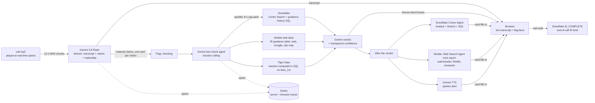
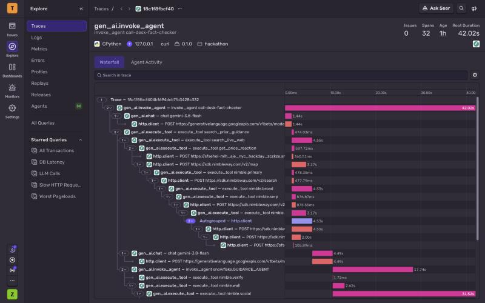
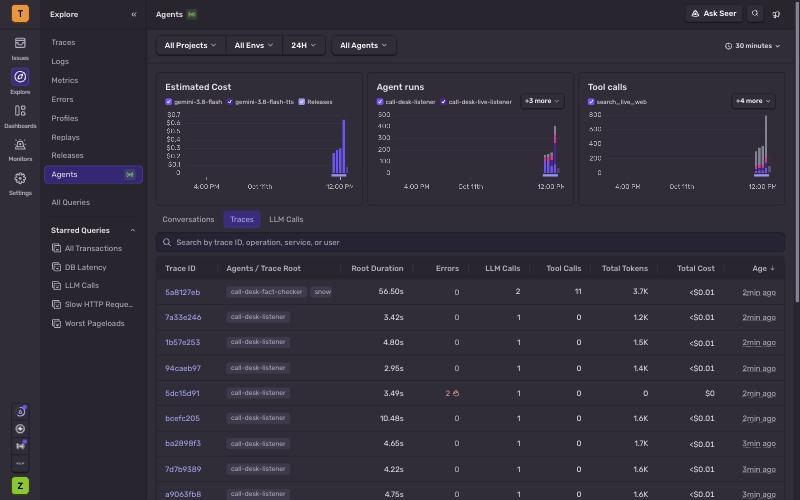

# Call Desk

**The stock moves the moment an executive says “we'll earn less than we said.” Call Desk tells you how much less, with proof, in seconds.**

[](LICENSE)   


<sub>A recorded live run, sped up 3×. PepsiCo's finance chief says "it's the margin piece that's driving the guide down in EPS". The red card then shows the new forecast: profit per share growing 2.5% to 3.5% this year, down from about 5%.</sub>

> Research demo built in one day. Not investment advice.

## What it does, in 30 seconds

Every three months, big companies like PepsiCo hold an **earnings call**. Their executives tell investors how the business is doing and what they expect next. One sentence can move the stock price.

On the call, executives often talk about a change without repeating the number. The number is in the company's press release, so listeners must stop and look it up. On October 8, 2026, PepsiCo's finance chief said "it's the margin piece that's driving the guide down in EPS". In plain words: *"We now expect profits to grow less than we said before."* The exact number was in that morning's press release, not in the sentence.

Call Desk listens to the call as it happens.

1. **About 12 seconds** after that sentence, a red card pops up: *PepsiCo lowered its profit forecast.*
2. **About 12 seconds later**, the card fills in with the answer:
   - **Before:** profit per share growing about 5% this year.
   - **Now:** growing only 2.5% to 3.5%.
   - **Proof:** PepsiCo's own press release from that morning, and the forecast it gave three months earlier.
   - **The stock:** how PepsiCo's stock moved, next to similar food and drink companies.
   - **How sure:** a confidence score of 98%. The evidence gave 92%, then two agents checked again and both agreed.

**Think of a sports announcer** who shouts "that changes the score!" but never says the score. Call Desk is the friend beside you who checks the scoreboard and says: "It was 5, now it's 3. Here's a photo of the scoreboard."

**Who it's for:** people who must keep up with many of these calls at once, such as investors, analysts, and teams that watch their competitors.

## How it works, in plain words

Five tools work together. Each one has one job.

| Job | What it does | Tool |
|---|---|---|
| **Listen** | Writes down the call as it happens and picks out sentences that could move the stock. | Gemini (Google's AI) |
| **Remember** | Looks up what the company forecast three months ago. | Snowflake |
| **Search** | Finds the company's own press release and news on the live web. | Nimble |
| **Watch the stock** | Measures how the stock moved right after the sentence, next to similar companies. | Tiger Data |
| **Keep a record** | Records every step the AI took, like a flight recorder, so anyone can check its work. | Sentry |

- Any number nobody said out loud on the call is labelled **"not spoken"**, with the place it came from.
- If a tool fails, the card says so and the confidence score goes down. The call keeps going.

### Words you'll see

| Word | Plain meaning |
|---|---|
| Earnings call | A call every three months where a company's executives tell investors how it is doing. |
| Q3 | The third three-month period of the year (July to September). |
| CFO | Chief financial officer: the executive in charge of the company's money. |
| Guidance | The company's forecast of how it will do this year. "Guide down" means it lowered the forecast. |
| EPS | Earnings per share: the company's profit divided by its number of shares. "Core EPS growth" on a card means how fast profit per share is growing. |
| Margin | The share of each sale that a company keeps as profit. |
| LOWERED / RAISED / UNCHANGED | The company lowered, raised, or kept a forecast. |
| PEP, KO, DAL | Stock symbols: PepsiCo, Coca-Cola, Delta Air Lines. |
| XLP, JETS | Funds that hold many similar companies (food and drink, airlines). Comparing with them shows whether the stock moved because of this company or because the whole group moved. |
| IR team | Investor relations: the people at a company who talk to investors. |
| Confidence | A score from 0% to 100%. It adds up three checks: does the old forecast back up the change, does the web back it up, and did the stock react. Then two agents check again: each one that agrees adds 3 points, and each one that disagrees takes away 10. It never goes above 98%. |

## Try it in one minute

You can watch the PepsiCo demo on your own computer. Replay mode plays a recorded live run of the call. It needs no API keys.

```bash
git clone https://github.com/zaeem-rafiq/Call-Desk-public.git && cd Call-Desk-public
uv venv --python 3.11 .venv && uv pip install --python .venv/bin/python -r requirements.txt
.venv/bin/python -m app.main --replay     # open http://localhost:8000/?start=132 and press "Play call"
```

`?start=132` starts 15 seconds before the finance chief's key sentence. Replay plays without the call audio. To hear the call, rebuild it with `scripts/fetch_audio.py` (see [Run it](#run-it)). To run the live pipeline on your own keys, see [Run it](#run-it) too.

## Results

All numbers come from one recorded live run: `20261011-150448` in `data/replay/latest/`, the run we show on stage. All five tools were live, at real-time speed, on one call. Nimble's checking agent reused its result from a live run at 2:47 PM ET the same day, and the card labels it "cached".

| What we measured | Result |
|---|---|
| Answer-key checks passed (`tests/golden.json`, written from the company's own press release) | 8 of 8 |
| From the finance chief's sentence to the red card on screen | about 12 s |
| From the sentence to the full answer, with the old and new numbers | about 24 s |
| Confidence score on the lowered profit forecast | 98%: 92% from the evidence, then 3 points each from Snowflake's agent and Nimble's check, which both agreed |
| Nimble's web research agent on that card (its live run at 2:47 PM ET, reused and labelled "cached") | SURE (its highest trust grade), 7 official sources, 17 s |
| Tiger Data: PepsiCo's stock (PEP) in the 30 minutes after the sentence, against a fund of food and drink companies (XLP) | 0.91 percentage points worse than the fund. Coca-Cola (KO) did 0.03 points better than the fund. Mondelez (MDLZ) and Keurig Dr Pepper (KDP) show no change, because nobody had traded them yet that morning (the market opens at 9:30 AM). The query took 3 ms. |
| Cards shown, errors, cards where the checking agent failed | 8, 0, 0 |

**It works on other companies too.** The second demo is **Delta Air Lines (DAL)**, from its call on October 9, 2026. Delta's finance chief reads the forecast out loud. Call Desk shows that Delta now expects to earn $5.10 to $5.60 per share this year, down from a range of $6.50 to $7.50. It compares Delta's stock with a fund of airlines (JETS). Its recorded live run, `20261011-145906`, passes 10 of 10 answer-key checks with 0 errors. Pick it in the header, or open `?call=dal_q3_2026`.

Speed depends on the network and on how busy the AI models are. These are single runs, not a benchmark.

## Under the hood (for engineers)



1. **Listen.** The pipeline plays `data/call.mp3` in 12-second chunks at real-time speed. For each chunk, Gemini receives the audio and the transcript of the last two chunks. It returns speaker turns and candidate claims, each scored for materiality for a team that already has the morning release.
2. **Flag.** Each claim scoring 0.6 or more becomes a flag at once, marked "checking". A metric gets one card per call; later mentions attach to it.
3. **Fact-check.** A Gemini agent with function calling asks for three tools in parallel, each capped at 8 s:
   - Snowflake: last quarter's guidance (Cortex Search) and the metric's guidance history (SQL);
   - Nimble: the company's own guidance table from its IR site, plus web, Google and site-map specialists;
   - Tiger Data: the price reaction against XLP, computed in SQL.

   A second Gemini call writes a structured verdict: the exact numbers, what changed, why it matters, the evidence with each source's stance, and the guidance table. A LOWERED or RAISED badge needs numbers on both sides.
4. **Score.** Confidence is a transparent weighted sum: `0.45 × prior + 0.35 × web + 0.20 × price`. The card shows each component and its reason. A failed tool scores 0 for its component. It lowers confidence and never crashes the feed.
5. **Re-check.** After the verdict is on screen, Snowflake's Cortex Agent and Nimble's Web Search Agent each re-check the claim on their own, Nimble's wall-breaker, Reddit and newswire specialists add reaction, and Gemini speaks an alert for a material cut or raise. They fill in the card and never change its numbers. The two agents do move the confidence score: each one that agrees with the card's direction adds 3 points (1.5 for a medium-trust Nimble answer), each one that disagrees takes away 10, low-trust answers count for nothing, and the score stops at 98%. The card shows each step, for example "92% → 95%". In the stage replay (run `20261011-150448`), both agents agreed, so PepsiCo's EPS card went from 92% to 98%. `CROSS_CHECK=0` turns them off.
6. **Brief.** When the call ends, the run's flags are written to Snowflake and `AI_COMPLETE` writes a headline and 3–5 bullets for the investor relations (IR) team inside Snowflake.

## Sponsor tools

- **Gemini API** (`gemini-3.8-flash`) is the ears and the brain. It does the work of five steps:
  - audio transcription and understanding, with speakers judged by what they say;
  - claim extraction with materiality scoring;
  - the fact-check agent with parallel function calling;
  - structured verdicts (slow calls are hedged: a duplicate request after 6–8 s, first answer wins);
  - spoken alerts with Gemini TTS (`gemini-3.8-flash-tts`). The sentence is built from the flag's own fields, so the voice never says a number the card doesn't show.
- **Nimble** is the web researcher. It runs a "web desk" of eight specialists for every flag, each on a different Nimble capability. They feed each other.
  - **Before the verdict**, four run in parallel within 6.5 s:
    - The *primary-source reader* uses standard-depth search limited to PepsiCo's IR site and the SEC. It returns the company's own guidance table (each line's current and previous value) in about 0.5 s. That table is the first web source in every verdict.
    - The *broad web search* runs the model's query plus a fixed recall query.
    - *Google right now* uses Fast SERP, with the standard SERP endpoint as a fallback.
    - The *IR site mapper* uses Map.
  - **After the verdict**, four more fill in the card:
    - The *verification agent* is a Web Search Agent run with `output_schema`, started from the document the primary reader found. It returns Nimble's trust report: a confidence grade, official sources, and citations for each claim. Agent runs are billed per task, so it runs only on numeric guidance lines, a run is never retried, a run past its deadline is collected later instead of repeated, and results are stored in `data/cache/nimble_verify.json` and reused (labelled "cached") unless `NIMBLE_VERIFY_FRESH=1`.
    - The *wall-breaker* uses Domain Knowledge to find which news sites run antibot systems (DataDome, Cloudflare and others), then reads the protected article with the driver Nimble recommends.
    - The *Reddit pulse* uses the pre-built `reddit_answers` Extract Template.
    - The *newswire* runs news search (`focus=news`), falling back to plain search.
- **Tiger Data** is the stock-price stopwatch. It stores prices. `price_ticks` is a hypertable that holds 1,461,976 price rows: 1-minute bars for 40 stocks over 30 days, September 14 to October 9, 2026 (`scripts/load_tiger_history.py`). In the columnstore they take 6.8× less space (107.8 MB → 15.9 MB). `bars_1m` is a 1-minute continuous aggregate with real-time aggregation. One SQL query over `bars_1m` computes PEP's move since each quote minus XLP's (the abnormal move), the day move and the close move, in about 2.5 ms on the server, with 59 times more data than before. The card shows the query and its speed.
- **Snowflake** is the memory of what each company said before. It holds the prior guidance and the call's flags. It never stores call transcripts.
  - **Cortex Search** runs over the Q2 2026 guidance documents, filtered by ticker. It answers questions such as "What was PepsiCo's core EPS guidance last quarter?"
  - **`GUIDANCE_LINES`** records every FY2026 guidance statement made before the call, from Dec 2025 to Jul 2026. The fact-check reads the metric's history from it by SQL, and the card draws that history as a timeline.
  - **The Cortex Agent `GUIDANCE_AGENT`** re-checks each claim after the verdict, inside Snowflake. It uses Cortex Analyst over the semantic view `GUIDANCE_SV`, Cortex Search, and SQL on the warehouse. The card shows its verdict (matches, changes or conflicts with prior guidance), the SQL it wrote, and the rows it read.
  - **The end-of-call brief.** The run's flags go into `CALL_FLAGS` (structured fields only), and one `AI_COMPLETE` query writes the IR brief inside Snowflake.
- **Sentry** is the flight recorder. It covers errors and AI agent monitoring:
  - Each flag is its own `gen_ai.invoke_agent` trace, with the quote-to-flag and quote-to-verdict latencies as measurements.
  - Every Gemini call is a `gen_ai.chat` span; every tool call, Nimble specialist and the Cortex Agent are spans in the same trace.
  - The browser loads Sentry's official SDK (pinned with its integrity hash) and records each card's render inside that flag's server trace.
  - Each flag links to its trace.
  - **What it caught today.** During a live run, issue `CALL-DESK-2` grouped 11 `TimeoutError`s in the fact-check agent: one Snowflake connection was making each flag's Cortex Agent wait for the previous one. The trace showed the agent spans queued end to end; the fix gave each run its own pooled connection, and three concurrent agent runs then finished in 22.7 s.

  

  

### Optional: streaming listener

`LISTENER=live` streams the call to the Gemini Live API instead of 12-second chunks. It puts flags on screen about 5 s sooner, but in our runs it split some numbers and speakers less cleanly, so the demo and the recorded replays use the 12-second listener (the default).

## Run it

```bash
uv venv --python 3.11 .venv
uv pip install --python .venv/bin/python -r requirements.txt
.venv/bin/python scripts/fetch_audio.py      # rebuilds data/call.mp3 from the public replay (yt-dlp + ffmpeg)
.venv/bin/python scripts/fetch_prices.py --date 2026-10-08 --tickers PEP SPY XLP --out data/prices.csv
cp .env.example .env        # fill in keys; any blank key runs that integration in mock mode
.venv/bin/python scripts/check_env.py --ping
.venv/bin/python -m app.main          # open http://localhost:8000 and press "Play call"
```

- **Seed the data stores.** Run `scripts/autoseed.py --watch` and it seeds each store as soon as its key appears. To seed by hand, run `scripts/seed_tiger.py` and `scripts/seed_snowflake.py`.
- **Golden eval.** Run `.venv/bin/python tests/eval.py`. It checks the EPS cut heard in the audio and the five FY2026 guidance lines with the correct direction. A run with Gemini mocked is labelled MOCK.
- **Unit tests.** Run `.venv/bin/python -m pytest -q`.
- **Live self-check.** Run `.venv/bin/python scripts/verify_live.py`. It sends three claims at once through every sponsor, live, and prints PASS, WARN or FAIL for each check (`--only tiger,voice,brief,sentry` runs just those). With the stored Nimble results it starts no agent runs.
- **Last-resort demo.** Run `.venv/bin/python -m app.main --replay`. It replays `data/replay/latest/` (the cached flags and transcript) with the original timing. Without the audio file `--replay` still works; a live run needs `data/call.mp3`.
- **Demo media.** Run `.venv/bin/python scripts/record_demo.py` after a UI change or a new replay cache. It records `docs/media/demo.gif` from replay mode with headless Chromium, plus a local `demo.mp4` with the call audio, which stays out of Git.

### Environment

| Variable | Unblocks |
|---|---|
| `GEMINI_API_KEY` | transcription, claim extraction, fact-check agent |
| `SENTRY_DSN`, `SENTRY_ORG` | error monitoring, AI agent traces, trace links |
| `TIGER_DATABASE_URL` | price reaction from Tiger Data |
| `SNOWFLAKE_ACCOUNT`, `SNOWFLAKE_USER`, `SNOWFLAKE_PASSWORD` (+ `_WAREHOUSE`, `_DATABASE`, `_SCHEMA`) | prior-guidance search |
| `NIMBLE_API_KEY` | live web evidence |

Set `MOCK_<NAME>=1` to force a mock even when a key is present. `ENRICH=0` turns off the after-verdict re-checks. `NIMBLE_VERIFY_FRESH=1` makes the Nimble verification agent run fresh instead of reusing a stored result (each run is billed).

## Data and honesty notes

- **Audio.** `data/call.mp3` is a 4 min 49 s clip of the real Q3 2026 Q&A webcast, starting 2:50 into the call. It comes from a public re-upload, because the official webcast needs registration. The clip clock assumes the call started at 8:15:00 ET, accurate to about ±2 minutes. The audio is not in this repository: `scripts/fetch_audio.py` rebuilds it from the public re-upload (needs yt-dlp and ffmpeg).
- **What the call does and doesn't say.** PepsiCo's live call was Q&A only. The guidance numbers appear only in the 6 AM release and the posted prepared remarks. Call Desk marks any number it did not hear on the call as "not spoken", with its source.
- **Prior-quarter data.** The prior-quarter warehouse (`data/prior/`) holds only information published before the Q3 call.
- **Evaluation-only text.** `data/q3_transcript.txt` and `data/raw/` are used only for evaluation and are never given to the agent. Neither is in this repository.
- **Call transcripts are not in this repository.** They are third-party text, so they stay on the developer's machine. Without them, the prior-quarter warehouse loads only our own summary, `data/prior/q2_2026_guidance.md`, which holds every guidance number the demo checks. PepsiCo posts its own call transcripts on its [investor earnings page](https://www.pepsico.com/investors/earnings).
- **Public repository.** It is made by `scripts/make_public_copy.py` and leaves out the call audio, the vendor price files and third-party transcripts; the scripts above rebuild the audio and prices locally.
- **Cached agent results.** A Nimble verification shown as "cached" is the stored result of an earlier live run of the same check, with its time.
- **Price data.** yfinance provides 1-minute bars, not trades. Each bar is loaded as four bar-derived ticks (open, high, low, close). The continuous aggregate rebuilds exact 1-minute OHLC from them. A live feed would insert real trades into the same hypertable. The yfinance bars are not in this repository: run `scripts/fetch_prices.py` before `scripts/seed_tiger.py` (the seed reads `data/prices.csv`). Without them the two CSV price tests are skipped.

## Tools used

MLH asks every team to name the AI tools it used. This section lists every AI tool used to build Call Desk and every tool Call Desk runs on. No other AI tools were used.

### AI tools used to build Call Desk

- **Claude Code (Claude Opus 5.5, with Claude Fable 5.1 for the demo recording and the MLH submission)** wrote and tested the code in this repository, researched the sponsor SDKs, and prepared the demo data. Every commit carries its co-author line. Zaeem Khan decided what to build and directed the work.
- **Official sponsor skills** gave Claude Code each sponsor's own guidance. Unmodified copies are in `.claude/skills/`:
  - `gemini-api-dev` from Google (`google-gemini/gemini-skills`),
  - `setup-timescaledb-hypertables` and `timescaledb-hyperfunctions` from Tiger Data (`timescale/pg-aiguide`),
  - `nimble-web-expert` from Nimble (`Nimbleway/agent-skills`).
- **whisper.cpp (`base.en` model)** ran offline during data preparation. It located the demo clip inside the full call and produced the transcript used in mock mode (`app/mocks/mock_call.json`).

### AI services inside Call Desk

[Sponsor tools](#sponsor-tools) describes each one in detail.

- **Gemini API (`gemini-3.8-flash`)** transcribes the call, extracts claims, runs the fact-check agent, and writes the verdicts. Gemini TTS (`gemini-3.8-flash-tts`) speaks a voice alert for each guidance cut or raise.
- **Snowflake Cortex** finds last quarter's guidance with Cortex Search. Its Cortex Agent, `GUIDANCE_AGENT`, re-checks each claim with Cortex Analyst; its orchestration model is `auto`, so Snowflake chooses the model (set `SNOWFLAKE_AGENT_MODEL` to pin one). When the call ends, `AI_COMPLETE` writes the IR brief inside Snowflake with Claude Sonnet 4.6 (`claude-sonnet-4-6`), or with Llama 3.3 70B (`llama3.3-70b`) if that model errors.
- **Nimble** searches and reads the live web. Its Web Search Agent returns a trust report with citations for each claim.

### Other services and libraries

- **Tiger Data** stores the price ticks and the 1-minute bars.
- **Sentry** records errors and traces every agent, model, and tool call.
- **Open-source Python libraries:** FastAPI, Uvicorn, google-genai, snowflake-connector-python, psycopg, sentry-sdk, httpx, pandas, pydantic, and yfinance. `requirements.txt` pins their versions.

## License

Call Desk is released under the [MIT License](LICENSE). The sponsor skills in `.claude/skills/` are unmodified copies that keep their own licenses, with each license file beside its skill: `gemini-api-dev`, `setup-timescaledb-hypertables` and `timescaledb-hyperfunctions` are Apache-2.0, and `nimble-web-expert` is MIT. [Data and honesty notes](#data-and-honesty-notes) lists the third-party files this repository leaves out.
